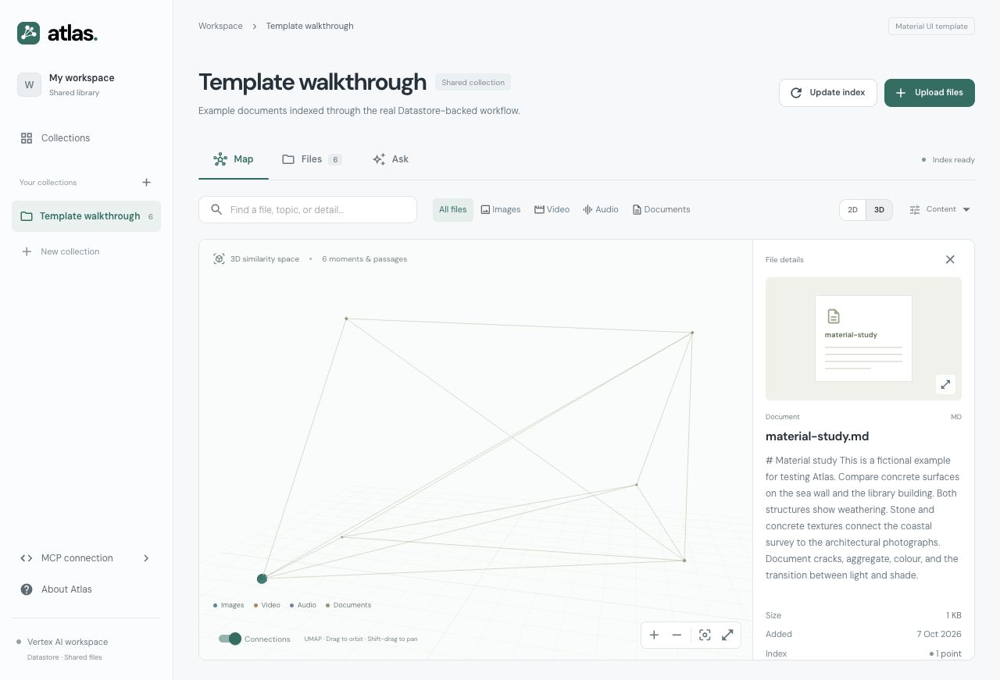

# Atlas

A Material UI workspace for uploading files, exploring their embeddings in **2D and 3D**, asking questions with sources, and connecting an assistant through **MCP**. One shared workspace, no sign-in.



Gemini runs on **Vertex AI**, authenticated with **gcloud Application Default Credentials** locally and an attached service account on Cloud Run. No API keys or service-account key files are required.

The backend uses **Firestore in Datastore mode**. It does not use Firestore Native mode or its vector-search APIs. Cloud Storage stores sources, previews, float32 vector snapshots, and map data. Cloud Run serves the app/API/MCP; Cloud Run Jobs perform indexing.

## What is implemented

- Upload and replace images, MP4/MOV video, MP3/WAV audio, PDFs, Markdown, and UTF-8 text. Preview originals, images, and timed media; source links include PDF pages and media time ranges.
- Incremental Gemini Embedding 2 indexing, descriptions, content-hash caches, durable job progress, and revision checks. Video's sound is indexed separately from its visual track.
- Versioned UMAP projections, with PCA for tiny collections. The 2D map shows the x/y plane of the same 3D projection. Colors identify file types. The Descriptions lens uses text-description embeddings.
- Backend cosine retrieval, query-image search API, related files, and Gemini Ask with query planning and numbered source references. Ask uses broad source coverage for summaries and whole-work explanations, and targeted retrieval for specific questions.
- Five read-only MCP tools over Streamable HTTP or stdio: `list_collections`, `get_collection`, `search`, `similar`, `get_item`. Optional inline preview images in `get_item`.
- A clearly labelled offline development provider for text/Markdown. It uses hashed word features and source excerpts, **not Gemini**. It never makes paid model calls.
- Tests, CI, a multi-stage Docker image, and a manual Google Cloud deployment script.

## Run locally

Install Python 3.12, [uv](https://docs.astral.sh/uv/), Node.js 22.12+, ffmpeg, Google Cloud CLI, and Java 21+.

```sh
cp .env.example .env
uv sync --frozen
gcloud components install cloud-firestore-emulator
```

Configure your Google Cloud identity once:

```sh
gcloud config set project YOUR_PROJECT_ID
gcloud auth application-default login
gcloud auth application-default set-quota-project YOUR_PROJECT_ID
gcloud services enable aiplatform.googleapis.com --project=YOUR_PROJECT_ID
```

Your identity needs Vertex AI User access in that project. Keep `ATLAS_PROVIDER=vertex` in `.env`. Locally, the model project is resolved from gcloud ADC; set `ATLAS_VERTEX_PROJECT` to override it. `ATLAS_VERTEX_LOCATION=global` is independent of the Cloud Run region. `ATLAS_PROJECT=atlas-local` remains the local Datastore emulator project. Google-standard `GOOGLE_CLOUD_PROJECT` and `GOOGLE_CLOUD_LOCATION` variables are also accepted for the model client.

For a walkthrough without model calls, set `ATLAS_PROVIDER=offline`. Application visitors never sign in; gcloud authentication belongs to the developer/server.

Start three terminals from the repository root:

```sh
# 1. Real Google emulator, explicitly in Datastore mode
./scripts/emulator.sh

# 2. Backend and local indexing worker
./scripts/dev.sh

# 3. Material UI frontend
cd frontend
npm ci
npm run dev
```

Open [Atlas](http://127.0.0.1:5178). Create a collection, upload the files in `examples/walkthrough`, select **Update index → Start update**, then explore Map and Ask. The app starts empty; it never imports the old browser-only preview records.

The emulator exports metadata to `.local/datastore-export` on a graceful exit and imports it next time. Objects live in `.local/objects`. Preserve both directories together. The local worker runs within the backend process; use Cloud Run Jobs for hosted indexing. If a worker disappears, its lease expires after 15 minutes and the UI allows another update.

## Connect MCP

A Streamable HTTP client can connect to:

```json
{
  "mcpServers": {
    "atlas": { "url": "http://127.0.0.1:5178/mcp/" }
  }
}
```

Client configuration formats differ; the MCP page displays the configured server URL. A cloud-hosted assistant needs a reachable hosted endpoint, not your localhost URL.

For a local stdio client, run from this repository:

```sh
DATASTORE_EMULATOR_HOST=127.0.0.1:8791 uv run python -m atlas.mcp_server
```

No OAuth or accounts are implemented. [Deployment instructions](docs/deployment.md) explain the shared-access model and Cloud Run setup.

## Tests

```sh
uv run ruff check backend
uv run pytest -q
# Include the real Datastore-mode emulator integration test:
DATASTORE_EMULATOR_HOST=127.0.0.1:8791 uv run pytest -q
cd frontend
npm run build
npm test
```

Tests cover upload validation, byte ranges, cache reuse, replacements, deletion races, partial failures, SDK request construction, media preprocessing, MCP calls, projections, and Datastore transactions. Gemini calls are replaced by test doubles in automated tests; passing these tests does not verify your project permissions or model access.

Initial validation also exercised live Vertex AI through ADC with synthetic text, image, PDF, audio, and video inputs, plus cited Ask and MCP search. The Docker image was built and run against the Datastore-mode emulator. Cloud resource provisioning must still be verified in the target deployment project.

## Layout

| Path | Responsibility |
| --- | --- |
| `backend/atlas/api.py` | HTTP API, previews/range requests, MCP mount |
| `backend/atlas/service.py` | Upload revisions, jobs, indexing, retrieval, Ask |
| `backend/atlas/repository.py` | Datastore-mode client and transactions |
| `backend/atlas/objects.py` | Local objects and Cloud Storage |
| `backend/atlas/media.py` | Bounded media/document preprocessing |
| `backend/atlas/ai.py` | Vertex AI with ADC and explicit offline provider |
| `backend/atlas/projection.py` | UMAP/PCA and nearest-neighbor edges |
| `frontend/src` | Material UI interface and 2D/3D maps |
| `deploy/deploy.sh` | Manual Cloud Run / Datastore / Storage setup |

See [architecture and API](docs/backend-contract.md), [deployment](docs/deployment.md), and [design notes](docs/design.md).

## Scope and limits

The default limits are 100 MB per upload, 250 segments per file, 10,000 indexed segments per collection, 5,000 model calls per UTC day, and 90 search/Ask HTTP requests per minute. Change them through environment settings. The indexer caches completed segments and unchanged sources; a failed model request may still have been billed by the provider. The UI estimate is a call-count upper bound, not a currency quote.

Ask overviews read indexed descriptions/passages in natural filename and within-file position order. They include all available sources within 512 passages and 128,000 serialized source characters; larger collections use a sample spread across files and positions, with limited coverage disclosed to the answer model. They do not rewatch original media. Only references actually cited in the answer are returned as source cards.

Hosted uploads go directly to a private GCS resumable session to avoid Cloud Run's request-body size limit. Every uploaded source is validated before being registered. Original codecs must be supported by the browser to play inline; indexing normalizes its own media segments independently.

This is a small-collection template: snapshots are cached in backend memory and vectors are ranked there. Very large libraries should use a dedicated vector-search service. Old revisions, segment caches, and superseded snapshots are private objects retained for recovery; add a retention/garbage-collection policy appropriate to your installation. Deleted assets are immediately excluded from serving, Ask, MCP, and search, but this is not a compliance-grade storage-erasure system.

No image/video generation, folder synchronization, per-user isolation, or automatic repository publication is included. The included deployment script provisions resources only when you explicitly run it.

## Licence

Original source code is MIT licensed. Dependencies and bundled fonts retain their respective licences. Example documents are synthetic. Runtime data and credentials are excluded from the repository.
