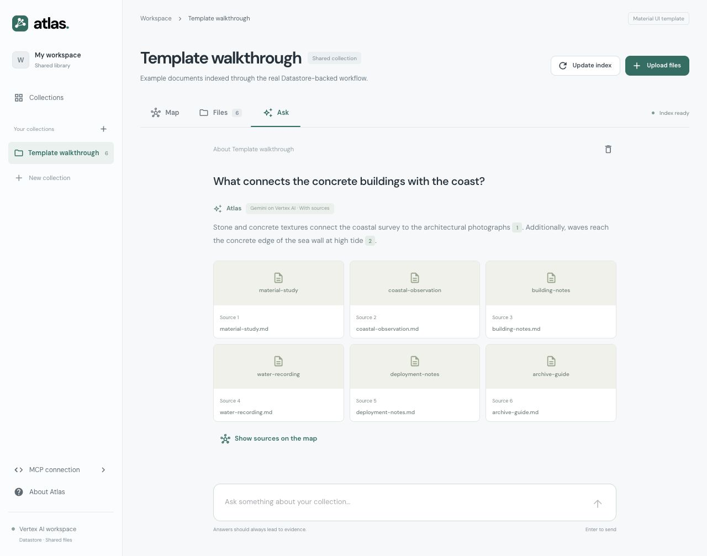

# Atlas interface

## Direction

A quiet research workspace. The primary object is the collection and its map, not a metrics dashboard or a promotional landing page. Material UI supplies navigation, tabs, dialogs, form controls, menus, notices, and the file table. The 2D map uses SVG for addressable interactive points. The 3D map uses a lazy-loaded Three.js scene with orbit controls, clickable points, and projected image previews. Both share the collection, search, filters, and selection.

The design uses a 222 px sidebar on wide displays, a compact breadcrumb/header, and a main work surface. The desktop map has an adjacent detail panel. At narrower widths the panel opens over the map after selection; navigation moves into a drawer on mobile.

## Tokens

- Workspace: `#f6f8fa`; surface: `#ffffff`; divider: `#e6eaee`.
- Main text: `#24313b`; secondary text: `#6c7781`.
- Action: `#176f63`; selected surface: `#e7f2ef`.
- Map groups: sea green `#468c88`, sandstone `#b1845d`, slate violet `#7b7eaa`, leaf grey `#8a9b70`.
- Typeface: self-hosted DM Sans Variable. Titles are compact; body copy remains plain and source-focused.
- Controls have 6–9 px corners; larger dialogs use 16 px. Borders define working regions. Avoid decorative shadows and gradients.

Map colors identify file types, not a relevance score. Search dims unmatched points; it does not move them. Points correspond to source passages or moments. Photos are preview annotations and can be selected. The Files view is the accessible equivalent.

## Map controls

Use the 2D/3D switch in the collection toolbar. In 3D, drag to orbit, Shift-drag or right-drag to pan, scroll or pinch to zoom, and click a point or photograph for file details. Arrow keys orbit a focused canvas; buttons zoom and reset the camera. Both views use the backend snapshot coordinates and neighbor edges. The camera stays in place while selecting or filtering files. If WebGL is unavailable, a fallback returns to 2D.

Colors represent Images, Video, Audio, and Documents; positions come from the embedding projection. The Content and Descriptions lenses have separate backend projections. Each point is a passage or timed segment, with a stable source ID.

## Interaction states

Create collection → upload → pending index → review estimate → durable indexing progress → published map. Replaced files receive new revisions; unchanged content reuses its cache. Per-file processing errors appear in the index dialog and file details.

Ask displays pending, error, and answered states. Every supplied source reference opens the corresponding file, page, or time range. Offline development results are explicitly labelled as source excerpts. Production answers use Gemini on Vertex AI for planning, shared retrieval, and grounding in the returned sources.

The browser is a client of the backend. It no longer seeds sample records or stores uploaded source bytes in IndexedDB. Conversation history stays in the current browser session and is sent as bounded context for follow-up questions. No cloud credentials are collected by this frontend.

## Connected previews

The screenshots use only the synthetic documents under `examples/walkthrough`, indexed through Vertex AI. They contain no private source material or cloud project identifiers.

